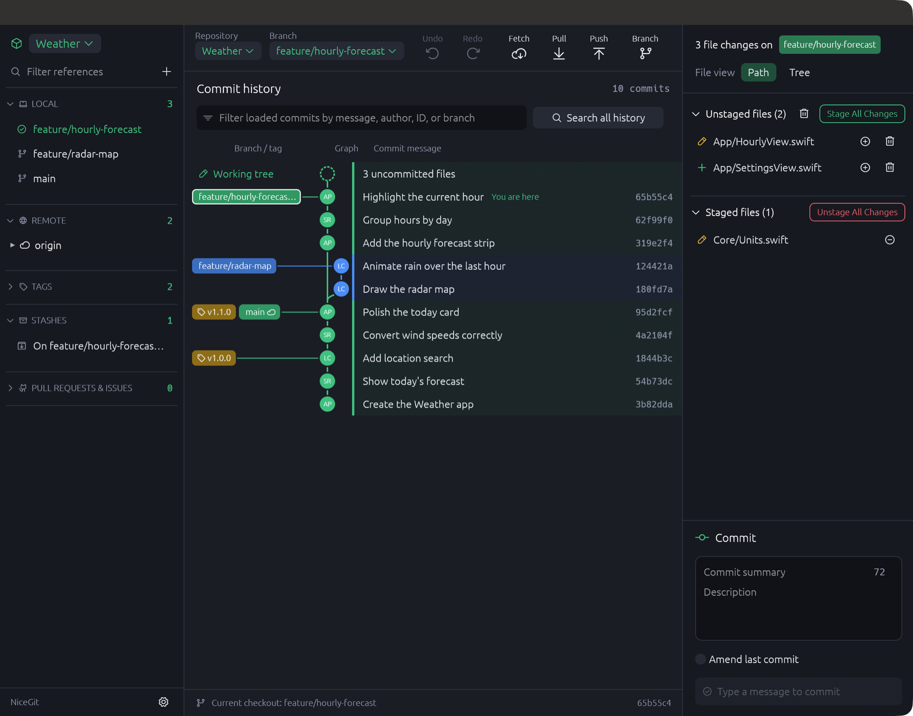

# NiceGit

**A fast Git client for macOS, Windows, and Linux. Free and open source.**



NiceGit puts your repositories, branches, history, and changes in one window.
Follow how commits connect, review and stage changes line by line, and rewrite history
with confidence: destructive actions confirm first, check that nothing changed behind
your back, and can usually be undone.

There is no account, subscription, or paid tier, and nothing is sent anywhere except by
Git itself. Built with Rust, and released under the [MIT License](LICENSE).

> **Preview software:** NiceGit is under active development. Back up important work
> before trying history-changing operations. The current version is 1.5.0.

## Highlights

**See your history**
- A commit graph with stable lanes and colours, branch and tag labels, author initials,
  and your uncommitted work connected to the commit it builds on.
- Blame any file, browse a file's history across renames, and compare any two commits
  or a commit with your working files, side by side or in one column.
- Search every branch's history by message, author, code change, or commit ID
  (Shift-Command-F), or search file contents at any commit (Option-Command-F).
- Show every branch, only local branches, or just the current branch and its upstream, and
  choose how much context diffs show, up to the whole file.

**Make changes**
- Stage and unstage whole files or individual lines, edit working files in place, and
  keep a separate commit draft for each checkout.
- Hover a change in a diff to stage, unstage, or discard just that change, and step
  through every changed file without leaving the diff.
- Interactive rebase: drag to reorder, and pick, reword, edit, squash, fix up, or drop
  commits. Edit the message of any commit on the branch, or fold staged changes into an
  older commit with Fix up.
- Merge, rebase, cherry-pick one or many commits, revert, amend, reset, and resolve
  conflicts, with a preview of which files will conflict before you start.
- Find the commit that introduced a bug with bisect, guided from the graph.

**Stay safe**
- Undo the last commit, merge, rebase, reset, pull, cherry-pick, or branch deletion, and
  undo discarding a file's changes.
- Recover commits left behind by a reset or rebase from **Repository › Recover Lost Work**.
- Every destructive action checks that the branch, commit, or remote you saw is still the
  one it will change, and refuses if it is not.
- Force push with a lease after rewriting pushed commits: the confirmation lists what the
  remote would lose, and the push is refused if someone else pushed since your last fetch.

**Manage repositories**
- Local and remote branches, tags, stashes (including selected files), linked worktrees,
  submodules, remotes, GitFlow, and Git LFS tracking.
- Branch clean-up for merged and inactive branches, identity profiles for work and
  personal email addresses, and commit signature status.
- Browse a stash's files and restore one, delete branches and tags from a remote, push a
  new tag as you create it, and save changes or a commit as a patch or ZIP archive.

**Work quickly**
- A command palette for actions, branches, and repositories (Shift-Command-P).
- An embedded terminal for each checkout (Control-backtick).
- Automatic refresh when files change in other apps, and a background fetch every 15
  minutes (adjustable in Settings).
- Every keyboard shortcut in one list (Command-/).
- See each changed file's added and removed lines, filter a long list of changes, commit
  and push in one step, and drag a folder onto the window to open it.
- Start messages from your commit.template, and add Signed-off-by and Co-authored-by lines
  from a menu.
- Light and dark appearance, and a colour-blind safe graph palette (Command-comma).
- Pull requests and issues, Open on GitHub, and cloning from your repository list, for
  github.com and GitHub Enterprise hosts, through your existing GitHub CLI login.

The [feature guide](docs/FEATURES.md) describes each feature's behaviour and safeguards.

## Install

### Download

Download the latest build for your system from
[Releases](https://github.com/daniaalnadir/NiceGit/releases):

| System | File |
| --- | --- |
| macOS 11 or newer (Apple Silicon and Intel) | `NiceGit-…-macos-universal.dmg` |
| Windows 10 or newer (64-bit) | `NiceGit-…-windows-x64.zip` |
| Debian, Ubuntu, and derivatives | `NiceGit-…-linux-amd64.deb` |
| Other Linux (x86_64) | `NiceGit-…-linux-x86_64.tar.gz` |

NiceGit is written in Rust; its source is in [`rust/`](rust). It includes the commit graph
and inspector, line-by-line staging, interactive rebase, conflict editing, undo, blame,
file history, search, bisect, comparisons, worktrees, submodules, GitFlow, Git LFS, pull
requests and issues, the command palette, and an embedded terminal.
[docs/PARITY.md](docs/PARITY.md) records how each feature of the original Mac app carried
over. Every version needs Git installed and on your `PATH`.

### Build from source

Install [Rust](https://rustup.rs) 1.95 or newer, then:

```sh
cd rust
cargo run --release
```

On Linux, first install the GTK 3, xkbcommon, and Wayland or X11 development
packages (for example `libgtk-3-dev libxkbcommon-dev libwayland-dev`). The tarball build
also needs `libxkbcommon-x11-0` and OpenGL (`libgl1`, `libegl1`) at run time; the `.deb`
installs them for you.

### Optional: GitHub pull requests and issues

Install [GitHub CLI](https://cli.github.com) and sign in:

```sh
gh auth login
```

Then choose a remote under **Pull Requests** or **Issues** in the sidebar. For GitHub
Enterprise Server, list your hosts under **Settings › GitHub Enterprise** and sign in with
`gh auth login --hostname <host>`. NiceGit reuses the CLI's login and stores no token of
its own; ordinary Git operations use your existing Git credentials.

## Development

```sh
cd rust
cargo test --workspace
```

`rust/scripts/test-all.sh` runs the same tests on macOS and Linux at the same time; see
[rust/README.md](rust/README.md).

Tests run against disposable repositories and need no GitHub login. The interface tests
in `rust/crates/nicegit/src/ui_tests*.rs` click and type through the real window. The one
test that reads GitHub is ignored by default, because it needs a GitHub CLI login; run it
with `cargo test -p nicegit -- --ignored github_pull_requests_and_issues_load_from_github`.

| Folder | Contents |
| --- | --- |
| `rust/crates/nicegit-core` | The Git commands, parsers, and commit graph |
| `rust/crates/nicegit-core/tests` | Integration tests against temporary repositories |
| `rust/crates/nicegit` | The interface; `src/tools` holds each feature window |
| `rust/scripts` | Packaging, the test runner, and a demo repository script |

[CONTRIBUTING.md](CONTRIBUTING.md) covers the workflow, and [AGENTS.md](AGENTS.md)
records hard-won rules about Git edge cases that changes must respect.

## Limitations

- Pull requests and issues support github.com and GitHub Enterprise Server, not GitLab or
  Bitbucket. Pushing and pulling work with any Git remote.
- Undo steps back through the last 20 recorded actions in this session; changes made outside
  NiceGit stop the chain.
- There are no automatic updates; download new versions from the Releases page.
- The embedded terminal is a real shell, and Git hooks, filters, and shell startup files
  can run code. Only open repositories you trust.

NiceGit is an independent project and is not affiliated with any other Git client.

## Contributing

Bug reports and focused pull requests are welcome. Please include your operating system
and version, the NiceGit version, and steps to reproduce with a disposable repository, and
remove private paths, repository content, and credentials from screenshots and logs.

- [Contribution guide](CONTRIBUTING.md)
- [Security policy](SECURITY.md)
- [Changelog](CHANGELOG.md)
- [Release checklist](docs/RELEASING.md)

## License

Copyright (c) 2026 Daniaal. Licensed under the [MIT License](LICENSE), which permits use,
modification, redistribution, and commercial use as long as the copyright and license
notices are kept. Dependencies keep their own licenses; see
[Third-Party Notices](THIRD_PARTY_NOTICES.md).
